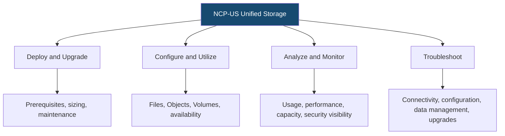
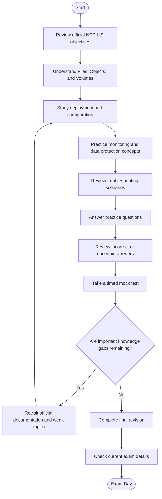
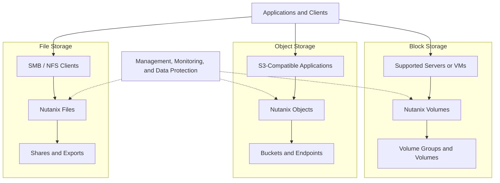
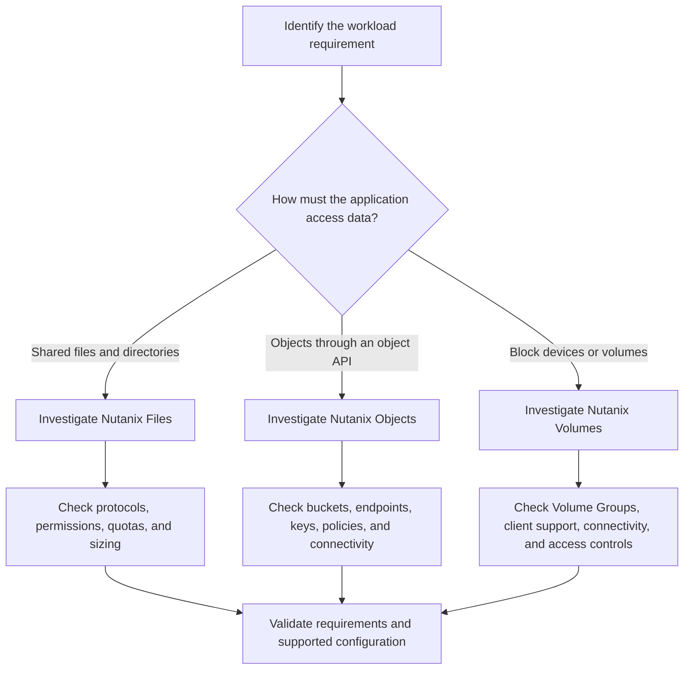
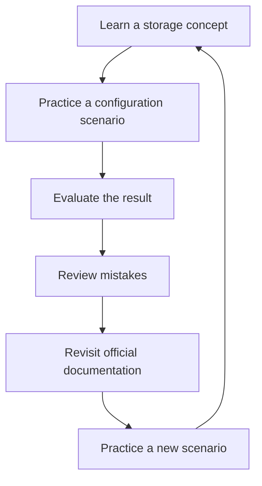
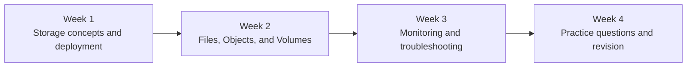

# Nutanix Certified Professional – Unified Storage (NCP-US) Study Guide

A practical study guide for the **Nutanix Certified Professional – Unified Storage (NCP-US)** certification. This repository helps IT professionals prepare for the exam by organizing the main objectives around Nutanix Files, Nutanix Objects, and Nutanix Volumes.

The focus is on the work storage administrators actually need to understand: deploying and maintaining storage services, configuring shares and buckets, presenting block storage, monitoring usage and performance, protecting data, and troubleshooting operational issues.

Use this guide alongside the official Nutanix exam objectives and product documentation. For supplementary certification-preparation material, see the [CertsGate NCP-US resource page](https://certsgate.com/exams/nutanix/ncp-us).

> **Version note:** Nutanix's current certification page identifies the NCP-US certification and links to its exam blueprint. This guide follows the current published objective areas. Confirm the active exam version, product versions, and exam policies with Nutanix before registering.

---

## Table of Contents

- [About the NCP-US Certification](#about-the-ncp-us-certification)
- [Who Should Prepare?](#who-should-prepare)
- [Exam Details](#exam-details)
- [The Three Nutanix Unified Storage Services](#the-three-nutanix-unified-storage-services)
- [Official Exam Objectives](#official-exam-objectives)
- [Conceptual Skills Map](#conceptual-skills-map)
- [Exam Preparation Flowchart](#exam-preparation-flowchart)
- [Unified Storage Architecture](#unified-storage-architecture)
- [Storage Selection Decision Guide](#storage-selection-decision-guide)
- [Circular Study Cycle](#circular-study-cycle)
- [Step-by-Step Preparation Strategy](#step-by-step-preparation-strategy)
- [Four-Week Study Roadmap](#four-week-study-roadmap)
- [Hands-On Practice Projects](#hands-on-practice-projects)
- [Original NCP-US Practice Questions](#original-ncp-us-practice-questions)
- [Troubleshooting Reference](#troubleshooting-reference)
- [Common Preparation Mistakes](#common-preparation-mistakes)
- [Readiness Checklist](#readiness-checklist)
- [Career Relevance](#career-relevance)
- [Frequently Asked Questions](#frequently-asked-questions)
- [Official and Additional Learning Resources](#official-and-additional-learning-resources)
- [About CertsGate](#about-certsgate)

---

## About the NCP-US Certification

The **Nutanix Certified Professional – Unified Storage (NCP-US)** certification validates the ability to deploy, configure, optimize, monitor, and troubleshoot Nutanix Unified Storage services.

The certification covers three major storage technologies:

- **Nutanix Files:** File storage services, including SMB and NFS shares or exports.
- **Nutanix Objects:** Object storage, including S3-compatible access, buckets, and related access configuration.
- **Nutanix Volumes:** Block storage presented to supported physical servers or virtual machines.

These technologies address different storage requirements. A shared department folder, an application using S3-compatible object storage, and a server requiring block storage do not necessarily need the same configuration.

Effective NCP-US preparation means understanding how to choose the appropriate service, determine prerequisites, configure it correctly, monitor its behavior, and troubleshoot issues when the result does not match expectations.

Start with the official [Nutanix NCP-US certification page](https://www.nutanix.com/support-services/training-certification/certifications/certification-details-nutanix-certified-professional-unified-storage-v6-10) and its linked exam blueprint.

## Who Should Prepare?

Nutanix describes a typical NCP-US candidate as having approximately:

- **1–2 years of general IT experience**
- **6–12 months of data storage experience**

The certification is relevant to IT professionals and IT architects who administer storage infrastructure and work with file, object, and block storage.

It may be particularly useful for:

- Storage administrators.
- Systems administrators.
- Infrastructure engineers.
- Virtualization administrators.
- IT support professionals working with storage services.
- Engineers responsible for data availability, monitoring, and storage troubleshooting.

You should be comfortable with basic networking, storage concepts, access permissions, and infrastructure administration. Familiarity with SMB, NFS, iSCSI, and S3 concepts will help you understand the product-specific objectives.

---

## Exam Details

The following details are published on Nutanix's certification page. Exam policies and availability can change, so check the official page before scheduling.

| Exam detail | Published information |
|---|---|
| Certification | Nutanix Certified Professional – Unified Storage |
| Exam code | NCP-US |
| Question count | 75 |
| Question format | Multiple-choice, according to the current certification page |
| Time limit | 120 minutes |
| Published languages | English and Japanese |
| Published price | US$200 per attempt |
| Recommended background | 1–2 years of general IT experience and 6–12 months of storage experience |
| Related training | Nutanix Unified Storage Administration (NUSA) |

The exam blueprint may contain additional information about question formats, scoring, delivery, and certification validity. Verify the latest version rather than relying on details copied from an older blueprint.

Official reference: [NCP-US certification and exam information](https://www.nutanix.com/support-services/training-certification/certifications/certification-details-nutanix-certified-professional-unified-storage-v6-10).

---

## The Three Nutanix Unified Storage Services

Understanding the differences between Files, Objects, and Volumes is a foundation for NCP-US preparation.

### Nutanix Files — File Storage

Nutanix Files provides file services for workloads that need shared file access. Relevant concepts include:

- SMB shares and NFS exports.
- Share and export permissions.
- Multi-protocol access where supported.
- Quotas and advanced file-service features.
- File server deployment and maintenance.
- Availability, data protection, and file-service troubleshooting.

**Example:** A team needs a shared folder for departmental documents. You would evaluate the file-service requirements, network and name-resolution prerequisites, access permissions, and the appropriate SMB or NFS configuration.

### Nutanix Objects — Object Storage

Nutanix Objects provides object storage for applications and data workflows that use object-based access.

Study:

- Object store deployment prerequisites.
- Buckets and namespaces.
- S3-compatible access and endpoints.
- Access keys and permissions.
- Bucket configuration and policies.
- Capacity and performance requirements.
- Object storage availability, data management, and troubleshooting.

**Example:** An application needs to store objects through an S3-compatible interface. You should understand the endpoint, bucket, credentials, connectivity, and access-policy requirements.

### Nutanix Volumes — Block Storage

Nutanix Volumes provides block storage that can be presented to supported physical servers or virtual machines.

Study:

- Volume Groups.
- Adding and removing volumes.
- Client connectivity.
- iSCSI concepts and configuration.
- CHAP authentication.
- Cluster and volume access controls.
- Storage presentation and troubleshooting.

**Example:** A supported server requires block storage for an application. The solution must account for the required volume configuration, connectivity, access controls, and client-side setup.

### Quick comparison

| Requirement | Storage service to investigate | Key concepts |
|---|---|---|
| Shared files and directories | Nutanix Files | SMB, NFS, permissions, quotas |
| Object-based application data | Nutanix Objects | Buckets, endpoints, access keys, S3-compatible access |
| Block storage for a supported client | Nutanix Volumes | Volume Groups, iSCSI, CHAP, connectivity |
| File usage analysis | File Analytics | Usage patterns and file activity |
| Storage security visibility | Data Lens and relevant security features | Data visibility, risk analysis, supported security capabilities |
| Storage performance investigation | Relevant Prism and storage monitoring tools | Usage, metrics, capacity, connectivity |

This table is an independent learning aid, not a replacement for product-specific compatibility and configuration documentation.

---

## Official Exam Objectives

Nutanix's current certification page groups the knowledge objectives into four sections. Use the official blueprint for the complete objective wording and associated technical references.

### Section 1 — Deploy and Upgrade Nutanix Unified Storage

This section covers preparing and maintaining Files and Objects deployments.

Review how to:

- Identify the steps required to deploy Nutanix Files.
- Identify the steps required to deploy Nutanix Objects.
- Perform upgrades and maintenance for Files and Objects.
- Determine appropriate product and sizing parameters for a given scenario.

Important preparation topics include:

- Network and connectivity prerequisites.
- DNS and NTP requirements.
- Supported protocols and deployment limitations.
- Capacity and performance requirements.
- Product sizing and scaling considerations.
- Dependencies between storage services and the underlying platform.
- Upgrade prerequisites and operational impact.

**How to prepare:** Practice explaining what must be checked before deployment, what information influences sizing, and how to verify that a service is ready for use.

### Section 2 — Configure and Utilize Nutanix Unified Storage

This section focuses on configuring storage services to meet workload requirements.

#### Nutanix Files

Review advanced file-service configuration, including SMB shares, NFS exports, multi-protocol access where supported, quotas, permissions, and relevant security or data-protection features.

#### Nutanix Volumes

Understand Volume Groups, block-storage presentation, client connectivity, and configuration requirements. Review relevant authentication and access-control concepts.

#### Nutanix Objects

Study object-store configuration, bucket creation, access keys, endpoint connectivity, namespaces, and relevant policies.

#### Scenario-based storage selection

Given a requirement, determine which service and configuration are appropriate. Distinguish between file, object, and block access rather than treating them as interchangeable.

#### Data availability and recoverability

Understand the available protection and recovery approaches that apply to the selected service. Verify the supported features and their prerequisites in the current documentation.

**How to prepare:** For every configuration, ask what the application needs, which service fits that need, what prerequisites apply, and how the configuration will be validated.

### Section 3 — Analyze and Monitor Nutanix Unified Storage

This section covers usage visibility, performance, capacity, and security-related monitoring.

Study how to:

- Use File Analytics to understand usage patterns and file activity.
- Monitor storage performance and usage.
- Use Prism Pro for capacity-planning scenarios.
- Understand the role of Data Lens in data-security visibility, as described in the applicable product documentation.

Practice distinguishing between a capacity problem, a performance problem, and an access or configuration issue.

**How to prepare:** Work through scenarios where usage increases, a client experiences slow access, or a security review requires better visibility into file activity. Identify which evidence and tools would help you investigate the issue.

### Section 4 — Troubleshoot Nutanix Unified Storage

This section tests your ability to investigate and resolve common operational problems.

Review how to:

- Troubleshoot Nutanix Files issues.
- Troubleshoot Nutanix Objects issues.
- Troubleshoot Nutanix Volumes issues.
- Explain data-management processes for Files and Objects.
- Troubleshoot a failed Files or Objects upgrade.

For troubleshooting scenarios, use a repeatable process:

1. Identify the affected service and the observed symptom.
2. Check prerequisites, connectivity, and configuration.
3. Review relevant monitoring information and logs.
4. Compare the evidence with the expected behavior.
5. Apply a documented corrective action.
6. Verify that the service works as required.

**How to prepare:** Learn to distinguish the symptom from its cause. For example, an inaccessible share could involve connectivity, name resolution, permissions, or service health. Investigate before changing unrelated settings.

For the complete objective descriptions and linked references, consult the [official NCP-US certification page](https://www.nutanix.com/support-services/training-certification/certifications/certification-details-nutanix-certified-professional-unified-storage-v6-10).

---

## Conceptual Skills Map

The diagram below is an independent study overview, **not an official exam-weighting chart**. No numerical weights are assigned because a verified current percentage breakdown has not been established here.

Use the map to organize your study notes and identify weak areas. The official blueprint remains the authoritative source for exam objectives.

---

## Exam Preparation Flowchart

This NCP-US preparation workflow connects official objectives with technical study, practice questions, and targeted revision.

Practice questions are most useful when they reveal which concepts need further study. Avoid repeating questions without understanding why an answer is correct.

---

## Unified Storage Architecture

The following is a conceptual learning diagram showing how different clients can use different storage services. It is not a complete deployment specification; actual components and network paths depend on the supported product configuration.

### What to understand from this diagram

- File storage exposes shared file access using supported protocols.
- Object storage organizes data into buckets and uses object-based access.
- Block storage presents volumes to supported clients.
- Each service has its own prerequisites, configuration options, and troubleshooting methods.
- Monitoring, availability, and protection must be evaluated in the context of the chosen service.

Use current Nutanix documentation to confirm supported protocols, network requirements, deployment constraints, and service-specific behavior.

---

## Storage Selection Decision Guide

When a scenario describes a workload, start by identifying the access pattern. This simple decision tree is a study aid, not a complete product-selection or compatibility matrix.

A good answer should explain why the selected service fits the workload and identify the configuration details that still need to be verified.

---

## Circular Study Cycle

NCP-US preparation benefits from repeated review rather than one pass through a list of definitions.

For example, after learning about SMB share permissions, practice explaining how access is configured, what additional conditions could affect access, and which checks would help troubleshoot an inaccessible share.

---

## Step-by-Step Preparation Strategy

### Step 1: Begin with the official blueprint

Read the current [NCP-US certification page and exam objectives](https://www.nutanix.com/support-services/training-certification/certifications/certification-details-nutanix-certified-professional-unified-storage-v6-10).

Create a checklist for all four sections. Mark each objective as:

- **Not started:** The concept is unfamiliar.
- **Learning:** You understand the basic idea but need further study.
- **Reviewed:** You have read the relevant documentation.
- **Ready to explain:** You can explain the concept and reason through a realistic scenario.

### Step 2: Learn the three storage models

Start with the differences between Files, Objects, and Volumes. For each service, understand its intended access model, common use cases, configuration requirements, and operational considerations.

A useful exercise is to write a short comparison explaining why a shared folder, an S3-compatible application, and a server needing block storage may require different approaches.

### Step 3: Study deployment and upgrades

Review the prerequisites for deploying Files and Objects. Pay attention to networking, name resolution, time synchronization, sizing, and supported configurations.

For maintenance topics, understand the dependencies and potential operational impact. Learn how to validate prerequisites and verify service health after a change.

### Step 4: Practice storage configuration

Study advanced Files configuration, Volumes, and Objects. Review shares, exports, quotas, permissions, Volume Groups, bucket configuration, access keys, and relevant protection features.

For each scenario, document:

1. The requirement.
2. The selected storage service.
3. The prerequisites.
4. The configuration decisions.
5. The verification steps.

### Step 5: Learn monitoring and capacity analysis

Review the purpose of File Analytics, Prism Pro capacity-planning capabilities, and the relevant monitoring options for performance and usage.

Practice deciding what evidence you would collect when capacity is increasing, a client reports slow access, or a security review requires more visibility into file activity.

### Step 6: Build a troubleshooting method

Organize your troubleshooting notes by service:

- Files: share access, permissions, connectivity, service health, and upgrade issues.
- Objects: endpoint access, buckets, credentials, policies, and connectivity.
- Volumes: client access, Volume Group configuration, connectivity, and access controls.

Use the official documentation to confirm service-specific procedures. Avoid assuming that a troubleshooting step for one storage type applies to another.

### Step 7: Use practice questions to find weak areas

Independent resources such as [CertsGate](https://certsgate.com/exams/nutanix/ncp-us) can supplement official documentation with study guides and practice material.

After each question:

1. Explain why the selected answer is correct.
2. Review why the alternatives do not fit the scenario.
3. Identify the related official objective.
4. Revisit the relevant Nutanix documentation.
5. Try a new scenario that tests the same concept.

### Step 8: Take a timed mock test

A timed mock test can help you identify gaps and practice pacing. Treat the result as a study diagnostic, not a guarantee of the official exam outcome.

### Step 9: Complete a final revision

Focus on objectives you cannot yet explain confidently. Revisit product selection, deployment prerequisites, configuration choices, monitoring, data availability, and troubleshooting.

---

## Four-Week Study Roadmap

This is an independent study recommendation, not an official Nutanix timetable. Adjust it according to your existing storage experience and access to a suitable practice environment.

| Week | Focus | Suggested activities |
|---|---|---|
| 1 | Fundamentals and deployment | Learn the three storage models, deployment prerequisites, sizing, and upgrade concepts |
| 2 | Configuration and utilization | Review SMB, NFS, buckets, endpoints, Volume Groups, permissions, and data availability |
| 3 | Monitoring and troubleshooting | Study File Analytics, performance and usage monitoring, capacity planning, and service-specific troubleshooting |
| 4 | Assessment and revision | Complete practice questions, review errors, take a timed mock test, and revisit weak objectives |

A practical routine is to combine concept study, technical documentation, and question review throughout the week. Keep a mistake log so that the final revision focuses on actual knowledge gaps.

---

## Hands-On Practice Projects

These are independent learning exercises, not official Nutanix exam labs. Use an authorized test environment and follow the documentation for the software version you are studying.

### Project 1: Compare file, object, and block storage

Create a comparison table for three fictional workloads:

- A team that needs shared documents.
- An application that stores objects through an API.
- A supported server that needs block storage.

For each, explain the appropriate service to investigate, the access method, the relevant prerequisites, and how you would validate connectivity.

### Project 2: Prepare a Files deployment checklist

Draft a deployment checklist covering:

- Client and storage networking.
- DNS and NTP requirements.
- Supported protocols.
- Share or export configuration.
- Permissions and access verification.
- Service-health checks before handoff.

Use the official documentation to confirm the requirements for the target environment.

### Project 3: Plan an Objects configuration

Create a hypothetical object-storage use case.

Document the required bucket, endpoint, access credentials, connectivity checks, and relevant policies. Explain how you would verify that an authorized client can access the intended objects without granting unnecessary access.

### Project 4: Design a Volumes presentation plan

Create a plan for presenting block storage to a supported client.

Include the Volume Group, volume configuration, client connectivity, applicable authentication, access controls, and verification steps. Confirm the supported setup in the current Nutanix documentation.

### Project 5: Investigate a storage performance issue

Imagine that users report slow access to a file share.

Write down the information you would collect, the monitoring tools you would consult, and the possible categories of causes. Explain how you would distinguish between a capacity issue, a connectivity problem, and a service or configuration issue.

### Project 6: Create a maintenance and recovery checklist

Draft a checklist for a planned Files or Objects maintenance operation. Include prerequisites, dependencies, expected impact, validation, and a plan for investigating a failed upgrade.

Keep the checklist aligned with supported procedures; do not use a production environment for unapproved experiments.

---

## Original NCP-US Practice Questions

The following questions are original educational examples created for this repository. They are **not official Nutanix exam questions**.

### Question 1: Choosing a storage service

An application needs to store and retrieve objects through an S3-compatible interface. Which Nutanix service should you investigate first?

A. Nutanix Files  
B. Nutanix Objects  
C. Nutanix Volumes  
D. Prism Pro

**Answer: B — Nutanix Objects.**

**Explanation:** Objects is the service associated with object storage. You would still need to verify endpoint configuration, bucket setup, credentials, policies, and connectivity requirements.

### Question 2: Shared file access

A team needs a shared directory accessed through SMB. Which service is the most relevant starting point?

A. Nutanix Objects  
B. Nutanix Volumes  
C. Nutanix Files  
D. A capacity report

**Answer: C — Nutanix Files.**

**Explanation:** Files provides file services, including SMB shares. Correct access also depends on the required permissions, connectivity, and service configuration.

### Question 3: Block storage

A supported server requires block storage. Which Nutanix service should you investigate?

A. Nutanix Files  
B. Nutanix Objects  
C. Nutanix Volumes  
D. File Analytics

**Answer: C — Nutanix Volumes.**

**Explanation:** Volumes is the block-storage service. The actual configuration must be checked against the client requirements and supported connectivity method.

### Question 4: Deployment readiness

Before handing over a new Files deployment, which approach is most appropriate?

A. Assume that successful deployment means every client can connect.  
B. Validate the required networking, name resolution, supported protocol, and client connectivity.  
C. Disable access controls to simplify testing.  
D. Skip service verification if the configuration screen shows no errors.

**Answer: B.**

**Explanation:** Deployment prerequisites and connectivity validation are important parts of a reliable handoff.

### Question 5: Storage monitoring

An administrator needs to understand file usage patterns. Which capability is specifically associated with file analytics?

A. File Analytics  
B. Volume Group configuration  
C. Object access keys  
D. A client-side text editor

**Answer: A — File Analytics.**

**Explanation:** File Analytics helps administrators understand file usage and activity. The exact information available depends on the product configuration and supported features.

### Question 6: Storage troubleshooting

A user cannot access a file share. What is the best first approach?

A. Reconfigure unrelated storage services.  
B. Delete the share immediately.  
C. Investigate the symptom, connectivity, permissions, configuration, and service health.  
D. Assume that all share failures are capacity problems.

**Answer: C.**

**Explanation:** Troubleshooting should be evidence-based. Several causes can produce similar symptoms, so investigate before applying a change.

### Question 7: Upgrade failure

An upgrade of a Files or Objects implementation fails. What should the administrator do next?

A. Repeat the upgrade without reviewing the error.  
B. Ignore the dependencies between the service and the underlying platform.  
C. Review the error, prerequisites, dependencies, and relevant logs, then follow the documented recovery procedure.  
D. Delete the storage service immediately.

**Answer: C.**

**Explanation:** The official objectives include troubleshooting failed Files or Objects upgrades. Diagnosis and documented remediation are preferable to blind retries.

### Question 8: Practice-question review

A candidate repeatedly misses questions about Volumes. What is the most useful next step?

A. Memorize the correct answer letters.  
B. Stop studying Volumes.  
C. Revisit the Volumes objectives and documentation, then work through a new block-storage scenario.  
D. Take more mock tests without reviewing errors.

**Answer: C.**

**Explanation:** Practice questions are most useful when incorrect answers lead to targeted study and a better understanding of the relevant configuration.

---

## Troubleshooting Reference

Use this table to organize your revision. It is a study aid, not a replacement for official product-specific troubleshooting procedures.

| Symptom | Areas to investigate | Related objective |
|---|---|---|
| Files deployment cannot be completed | Deployment prerequisites, networking, DNS, NTP, supported protocols | Deploy and upgrade |
| A user cannot access an SMB share | Connectivity, permissions, share configuration, service health | Configure and troubleshoot Files |
| NFS access does not work as expected | Export configuration, network reachability, supported access settings | Configure and troubleshoot Files |
| An object client cannot reach an endpoint | Endpoint configuration, DNS, connectivity, access keys, policies | Configure and troubleshoot Objects |
| A client cannot access a bucket | Bucket configuration, credentials, policies, endpoint settings | Configure Objects |
| A block-storage client cannot access a volume | Volume Group configuration, client connectivity, access controls, authentication | Configure and troubleshoot Volumes |
| Storage usage is increasing | Usage information, capacity, workload growth, planning tools | Analyze and monitor |
| File activity requires investigation | File Analytics and the relevant security visibility tools | Analyze and monitor |
| Files or Objects maintenance fails | Upgrade prerequisites, dependencies, error details, relevant logs | Deploy, upgrade, and troubleshoot |

### A repeatable troubleshooting process

1. **Define the symptom.** Record the affected service, client, and observed behavior.
2. **Collect evidence.** Check relevant configuration, connectivity, monitoring information, and logs.
3. **Check prerequisites.** Verify the supported protocol, endpoint, permissions, and dependencies.
4. **Narrow the cause.** Separate access, network, capacity, performance, and service-health issues.
5. **Consult official documentation.** Select the procedure that matches the product and software version.
6. **Apply a controlled remediation.** Follow approved operational procedures.
7. **Validate the result.** Confirm that the client or application can perform the required operation.

---

## Common Preparation Mistakes

### Confusing Files, Objects, and Volumes

Learn the access model and intended use case for each service. A question about shares is not automatically a question about block storage, and an S3-compatible requirement points toward a different storage model.

### Memorizing names without understanding prerequisites

Deployment and configuration depend on networking, connectivity, sizing, and other requirements. Understand why each prerequisite matters.

### Ignoring permissions and access controls

A service can be running while a client still cannot access the intended data. Review permissions, credentials, policies, and relevant authentication mechanisms.

### Studying configuration but skipping monitoring

The objectives include performance, usage, File Analytics, and capacity planning. Learn how to interpret evidence, not just how to create a storage resource.

### Assuming every storage service is configured the same way

Files, Objects, and Volumes have different interfaces and operational workflows. Use service-specific documentation.

### Practicing questions without reviewing errors

A correct answer is not enough if you cannot explain it. Map mistakes to official objectives and revisit the underlying concept.

### Relying on outdated documentation

Product features and exam objectives change. Check that your study material and procedures align with the current certification page and applicable product documentation.

---

## Readiness Checklist

Use this checklist before the exam.

- [ ] I have reviewed the current official NCP-US objectives.
- [ ] I can explain the differences among Files, Objects, and Volumes.
- [ ] I understand Files deployment prerequisites.
- [ ] I can explain SMB shares, NFS exports, permissions, and relevant advanced Files features.
- [ ] I understand Objects deployment requirements, buckets, endpoints, access keys, and policies.
- [ ] I understand Volume Groups and block-storage presentation.
- [ ] I can reason through storage selection scenarios.
- [ ] I understand the importance of data availability and recoverability.
- [ ] I know how File Analytics helps investigate usage patterns.
- [ ] I understand the purpose of performance and usage monitoring.
- [ ] I can explain the role of Prism Pro in capacity planning where applicable.
- [ ] I can structure a troubleshooting investigation for Files.
- [ ] I can structure a troubleshooting investigation for Objects.
- [ ] I can structure a troubleshooting investigation for Volumes.
- [ ] I understand the need to investigate dependencies and errors during failed upgrades.
- [ ] I have reviewed incorrect and uncertain practice-question answers.
- [ ] I have taken a timed practice test and identified weak areas.
- [ ] I have checked the current exam version, price, languages, and scheduling details.

If several items remain unchecked, use them to guide another focused revision cycle.

---

## Career Relevance

NCP-US preparation is relevant to professionals responsible for storage administration and data services in Nutanix environments.

Related roles may include:

- Storage administrator.
- Systems administrator.
- Infrastructure engineer.
- Virtualization administrator.
- Data-center operations specialist.
- IT support engineer working with enterprise storage.

The certification can help demonstrate knowledge of Nutanix Unified Storage technologies. Career opportunities also depend on hands-on experience, broader infrastructure skills, and employer requirements; certification alone does not guarantee employment or promotion.

## Frequently Asked Questions

### What does NCP-US stand for?

NCP-US stands for **Nutanix Certified Professional – Unified Storage**.

### Which products are covered?

The core storage technologies are Nutanix Files, Nutanix Objects, and Nutanix Volumes.

### How many questions are on the NCP-US exam?

Nutanix's current certification page lists 75 questions. Check the active exam blueprint for the exact format and any version-specific details.

### How long is the exam?

The current certification page lists a time limit of 120 minutes.

### What experience is recommended?

Nutanix describes a typical candidate as having approximately one to two years of general IT experience and six to twelve months of data storage experience.

### Is a training course mandatory?

The related Nutanix Unified Storage Administration (NUSA) course is recommended, but the certification page does not list it as a mandatory prerequisite. Confirm current requirements on the official site.

### Are third-party practice questions enough?

They are best used as supplementary material. Combine practice questions with the official blueprint, product documentation, and practical exercises. Review incorrect answers to identify the underlying knowledge gap.

### Where can I find the official exam objectives?

Start with the [NCP-US certification page](https://www.nutanix.com/support-services/training-certification/certifications/certification-details-nutanix-certified-professional-unified-storage-v6-10), which provides the knowledge objectives and links to the exam blueprint.

---

## Official and Additional Learning Resources

Use official Nutanix resources as the primary reference for exam requirements and product behavior.

| Resource | How to use it |
|---|---|
| [NCP-US certification page](https://www.nutanix.com/support-services/training-certification/certifications/certification-details-nutanix-certified-professional-unified-storage-v6-10) | Current certification information, knowledge objectives, exam details, and blueprint links |
| [Nutanix Unified Storage Administration training](https://www.nutanix.com/support-services/training-certification/training) | Official training for installing, configuring, managing, and upgrading Unified Storage |
| [Nutanix Documentation Portal](https://portal.nutanix.com/page/documents/list) | Product documentation, deployment requirements, configuration procedures, and troubleshooting guidance |
| [Nutanix Developer Portal](https://www.nutanix.dev/) | Developer and API-related learning resources where relevant |
| [Nutanix Community](https://next.nutanix.com/) | Community discussions and technical learning |
| [Nutanix Test Drive](https://www.nutanix.com/test-drive) | Guided exploration of available product experiences |
| [CertsGate NCP-US resources](https://certsgate.com/exams/nutanix/ncp-us) | Independent supplementary study and practice materials |

Some technical documentation may require a Nutanix Support Portal account or appropriate access. Confirm that each reference applies to your product version and configuration.

---

## About CertsGate

[CertsGate](https://certsgate.com/) is an independent IT certification preparation resource. Its study guides and practice materials can complement official documentation and practical learning.

For NCP-US preparation, supplementary practice questions can help reinforce storage selection, deployment, configuration, monitoring, data availability, and troubleshooting concepts. Use incorrect answers to identify weak areas, then verify the underlying technical details against the official Nutanix documentation.

CertsGate is included as an independent learning resource. This repository does not claim an official partnership or endorsement by Nutanix, and third-party study material should not replace the official exam blueprint.
